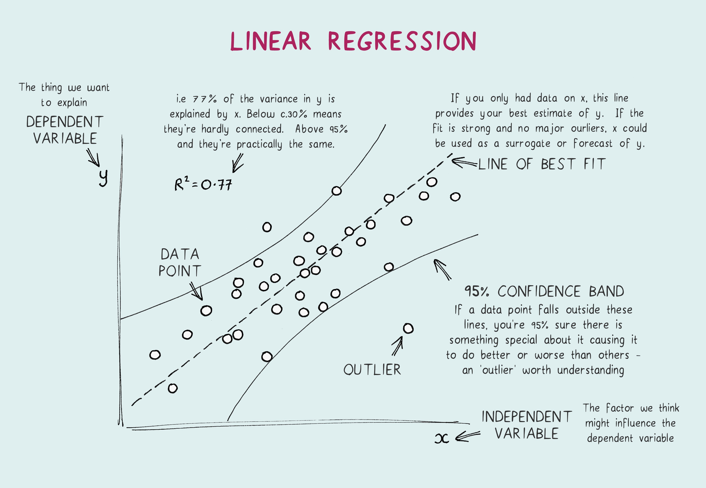
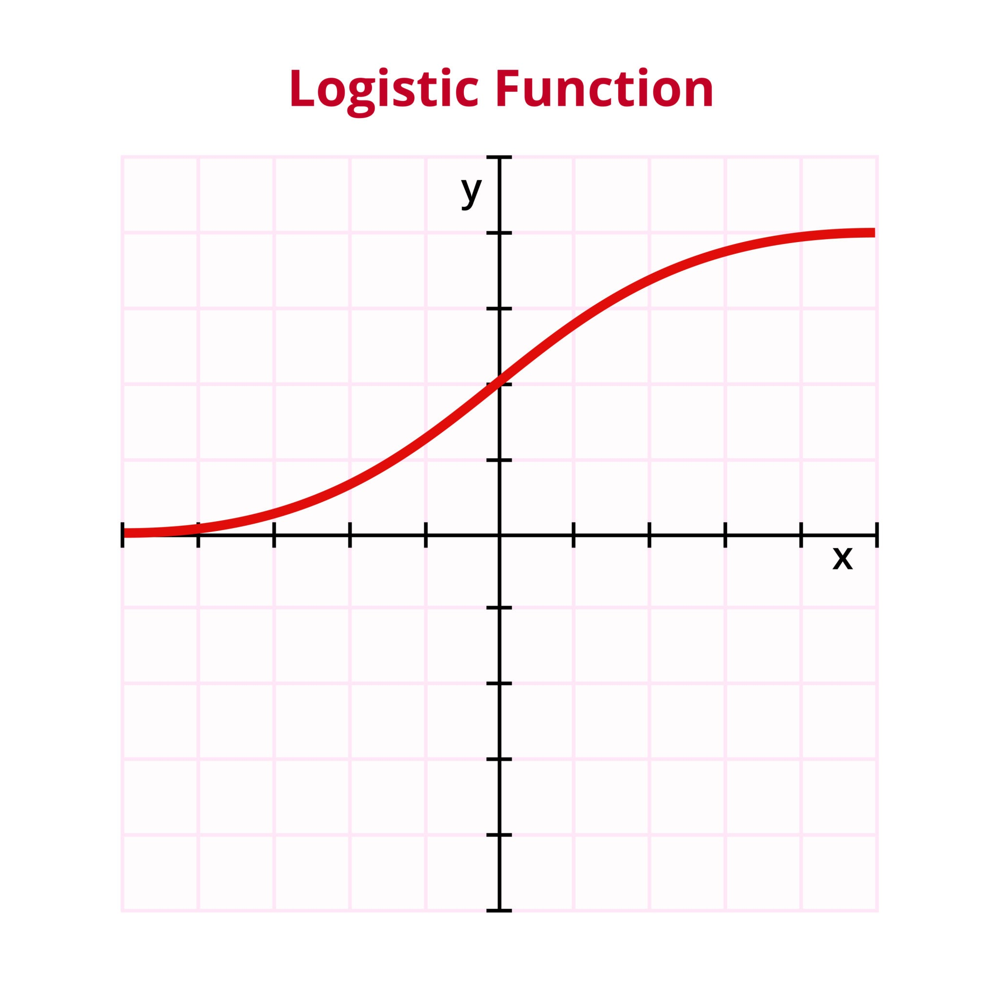

# 📚 Guia de Estudo: Prova de Machine Learning (Fatec Votorantim)

## 📍 Aula 02: Fundamentos de Aprendizado de Máquina (ML)

### Conceito: O que é Machine Learning?
* **Nível 1 (Simples e Intuitivo):** É ensinar o computador a aprender sozinho usando exemplos (dados), em vez de um humano escrever todas as regras na mão.
* **Nível 2 (Técnico):** É a representação matemática (modelo) que detecta automaticamente padrões a partir de características presentes em um dataset. O modelo é treinado com dados conhecidos e avaliado com dados que nunca viu para gerar predições.
* **Exemplo da aula:** Em vez de programar regras rígidas para identificar spam, você entrega milhares de e-mails normais e spams ao algoritmo, e ele aprende a diferenciá-los.
* 🚨 **Pegadinha de Prova:** Achar que ML é "inteligência artificial com consciência" (tipo Jarvis ou Exterminador do Futuro). A aula foca que ML é puramente encontrar padrões matemáticos em dados.

### Conceito: Tipos de Aprendizado
* **Nível 1 (Simples):** * *Supervisionado:* O professor dá a pergunta e a resposta (gabarito).
  * *Não Supervisionado:* O professor dá só os dados e o robô tenta organizá-los sozinho.
  * *Reforço:* O robô aprende na base da tentativa, erro e recompensa.
* **Nível 2 (Técnico):** * *Supervisionado:* Usa dados rotulados (labels) para mapear entradas para saídas (Regressão e Classificação).
  * *Não Supervisionado:* Usa dados sem rótulos para encontrar estruturas latentes (ex: Clusterização/Agrupamento).
* **Exemplo da aula:** Prever churn (cancelamento) de clientes é supervisionado. Agrupar clientes por perfil de compra é não supervisionado.

---

## 📍 Aula 03: Pré-processamento e Engenharia de Características

### Conceito: Limpeza de Dados (Missing Values e Outliers)
* **Nível 1 (Simples):** Dados do mundo real vêm com defeitos (células vazias ou valores bizarros, como idade = 200 anos). Se você não limpar, o modelo aprende errado.
* **Nível 2 (Técnico):** O pré-processamento é a etapa mais demorada do pipeline. Envolve **Imputação** (preencher valores faltantes com média/mediana), remoção de dados, e tratamento de **Outliers** (anomalias que fogem do padrão estatístico).
* **Exemplo da aula:** Preencher a coluna de "Renda" em branco com a renda média dos outros usuários, ou limitar dados absurdos de vendas na Black Friday (clipping).

### Conceito: Transformação e Escalonamento
* **Nível 1 (Simples):** Algoritmos são sensíveis a números grandes. Se o salário é 5000 e a idade é 25, o algoritmo pode achar que o salário é mais importante só por ser maior. Colocamos tudo na mesma "régua".
* **Nível 2 (Técnico):** Aplicação de Normalização ou Padronização (Z-score) para deixar as variáveis numéricas na mesma escala.
* 🚨 **Pegadinha de Prova (MUITO IMPORTANTE):** *Data Leakage (Vazamento de Dados)*. Você **nunca** deve usar os dados do conjunto de Teste para calcular a média e escalonar os dados. O escalonamento deve ser aprendido APENAS no conjunto de Treino e então aplicado ao Teste.

---

## 📍 Aula 04: Regressão Linear e Regularização

### Conceito: Regressão Linear e Função de Custo (MSE)
* **Nível 1 (Simples):** Tenta traçar uma linha reta que passe o mais perto possível de todos os pontos de um gráfico para prever um número futuro. O MSE mede o "tamanho do erro" dessa linha.
* **Nível 2 (Técnico):** É um modelo que prevê valores *contínuos*. Ele ajusta seus parâmetros (pesos/coeficientes) para minimizar a Função de Custo, que no caso é o **MSE (Erro Quadrático Médio)**.
* **Exemplo da aula:** Prever o "nível de satisfação das pessoas" com base na renda delas, ou prever preços de imóveis.

### Conceito: Gradiente Descendente

* **Nível 1 (Simples):** É o método que o modelo usa para corrigir os erros passo a passo. Imagine descer uma montanha de olhos vendados: você sente a inclinação e dá um passo para baixo até chegar no fundo (menor erro).
* **Nível 2 (Técnico):** Algoritmo de otimização iterativo. Ele calcula o gradiente da função de erro e atualiza os pesos multiplicados por uma **Taxa de Aprendizado ($\eta$ ou $\alpha$)**. Se a taxa for muito grande, ele não converge; se for muito pequena, demora demais.

### Conceito: Overfitting e Regularização
* **Nível 1 (Simples):** Overfitting é quando o modelo "decora" o treino, cria uma curva super complexa, mas erra tudo em dados novos. Regularização é a "punição" para evitar que o modelo fique complexo demais.
* **Nível 2 (Técnico):** A Regressão Polinomial de alto grau causa overfitting. Usamos regularização para restringir os pesos:
  * **Ridge (L2):** Penaliza pesos grandes, mantendo o modelo estável.
  * **Lasso (L1):** Tende a zerar completamente as características inúteis (faz seleção de *features*).

---

## 📍 Aula 05: Regressão Logística e Classificação

### Conceito: Regressão Logística e Função Sigmoide

* **Nível 1 (Simples):** Apesar do nome "Regressão", ela serve para separar as coisas em grupos (Classificação). Ela cospe uma probabilidade (ex: 80% de chance de ser um gato). Se passar do limite (Threshold de 50%), ele diz que é gato.
* **Nível 2 (Técnico):** Utiliza a **Função Sigmoide** para transformar a saída linear em um valor entre 0 e 1. A função de custo não é o MSE (pois não seria convexa), mas sim o **Log Loss (Entropia Cruzada)**.
* 🚨 **Pegadinha de Prova:** Regressão Logística NÃO prevê valores contínuos (como preço), ela prevê **Categorias/Classes** (Sim/Não, Fraude/Não Fraude).

### Conceito: Métricas de Avaliação

* **Nível 1 (Simples):** Acurácia (taxa de acertos geral) engana muito. Precisamos saber se o modelo está errando ao acusar falsos positivos ou falsos negativos.
* **Nível 2 (Técnico):** Extraídas da Matriz de Confusão:
  * **Precisão:** De todos que o modelo disse ser Positivo, quantos realmente eram? (Útil quando Falso Positivo é caro).
  * **Recall (Revocação):** De todos os Positivos reais, quantos o modelo encontrou? (Útil quando Falso Negativo é perigoso, ex: doenças).
  * **F1-Score:** Média harmônica entre Precisão e Recall.

---

## 📍 Aula 06: O Pipeline Completo (Ponta a Ponta)

### Conceito: A Estrutura de um Projeto de ML
* **Nível 1 (Simples):** É a receita de bolo completa, desde pegar o arquivo de dados até salvar o modelo finalizado num formato que um site ou aplicativo possa usar.
* **Nível 2 (Técnico):** Segue as etapas: 
  1. Entendimento do Negócio (Ex: Prever preço de casas na Califórnia para ajudar corretores).
  2. Obtenção e Separação dos Dados (`train_test_split`).
  3. Exploração e Pré-processamento (Criar pipelines com Imputers e Scalers).
  4. Treinamento e Seleção de Modelos (Avaliar com RMSE).
  5. Ajuste Fino e Validação no Teste.
  6. **Deploy:** Salvar o modelo usando a biblioteca `joblib` (ex: `joblib.dump(modelo, "modelo.pkl")`) para colocá-lo em Produção.

Sim, há alguns conceitos "faixa-preta" e vocabulários específicos que estavam espalhados nos slides e cadernos práticos (*notebooks*) que valem muito a pena adicionar ao seu arquivo `.md`. Eles costumam ser o diferencial para gabaritar questões teóricas mais profundas.

Aqui estão os complementos estratégicos para fechar o seu guia de estudos com chave de ouro:

---

## 📍 Adendos de Ouro para a Prova

### 1. Vocabulário Oficial de ML (Aula 02)
Se a prova pedir definições exatas, use estas:
* **Modelo:** É a representação matemática final que aprendeu os padrões a partir dos dados (ex: a equação da reta salva no final).
* **Treinamento (Fit):** É o *processo* em que o modelo ajusta seus parâmetros (pesos) repetidas vezes usando os dados de treino.
* **Métrica / Erro:** É a régua usada para medir quão boa (ou ruim) está a predição do modelo (ex: MSE, Acurácia).

### 2. MSE vs. RMSE (Aula 04 e 06)
* **Nível 1 (Simples):** O MSE eleva o erro ao quadrado, o que distorce a unidade de medida (se você prevê preços em Reais, o MSE te dá "Reais ao quadrado", o que não faz sentido). O **RMSE (Root Mean Squared Error)** tira a raiz quadrada disso para voltar à unidade original.
* **Nível 2 (Técnico):** O RMSE penaliza erros grandes da mesma forma que o MSE, mas é mais interpretável para o negócio porque está na mesma escala da variável alvo (*target*).

### 3. Equação Normal *vs.* Gradiente Descendente (Aula 04)
* **Nível 1 (Simples):** A Equação Normal é uma fórmula mágica que resolve o problema matemático de uma vez só. O Gradiente Descendente resolve na base da tentativa e correção passo a passo.
* **Nível 2 (Técnico):** A **Equação Normal** é uma solução analítica. É ótima para bases de dados pequenas, mas fica extremamente lenta se houver milhares de características (*features*), pois exige a inversão de matrizes. O **Gradiente Descendente** é iterativo e escala muito bem para conjuntos de dados gigantes e modelos complexos (desde que os dados estejam escalonados).

### 4. Fronteira de Decisão e Multiclasse (Aula 05)
* **Nível 1 (Simples):** Na Regressão Logística, a Fronteira de Decisão é a "linha no chão" que o modelo desenha para separar os gatos dos cachorros.
* **Nível 2 (Técnico):** É o limite onde a probabilidade calculada pela Sigmoide é exatamente igual ao *Threshold* (ex: 50%). Para problemas **Multiclasse** (ex: classificar entre Gato, Cachorro e Pássaro), usamos estratégias como *One-vs-Rest (OvR)*, onde o modelo treina um classificador binário para cada classe contra todas as outras, ou a função *Softmax*.

### 5. Ajuste Fino de Hiperparâmetros (Aula 06)
* **Nível 1 (Simples):** Parâmetros são os pesos que a máquina aprende sozinha. Hiperparâmetros são os "botões" que o humano configura antes de ligar a máquina (ex: o grau do polinômio, o valor do $C$ na logística, a taxa de aprendizado).
* **Nível 2 (Técnico):** Para não chutar esses valores às cegas, usamos técnicas de otimização, testando várias combinações automaticamente no conjunto de validação, para encontrar a configuração que gera o menor erro antes do teste final.

---

### Tema 1: Fundamentos de Machine Learning (Aula 02)

**Pergunta 1:** Qual a principal diferença entre um sistema de programação tradicional e um sistema baseado em Aprendizado de Máquina (Machine Learning)? Dê um exemplo.
**Resposta:** Na programação tradicional, o desenvolvedor escreve regras lógicas explícitas (código com condições *if/else*) e insere dados para obter as respostas. No Aprendizado de Máquina, nós fornecemos os dados e as respostas esperadas (no caso do aprendizado supervisionado), e o algoritmo é responsável por descobrir matematicamente as regras e padrões. 
*Exemplo:* Em vez de programar uma regra rígida dizendo "se o e-mail contiver a palavra 'oferta', é spam" (tradicional), nós damos ao modelo milhares de e-mails normais e milhares de spams, e ele aprende sozinho as correlações de palavras que definem um spam.

**Pergunta 2:** Defina os três principais tipos de Aprendizado de Máquina e cite o objetivo de cada um.
**Resposta:**
1. **Supervisionado:** O modelo aprende a partir de dados previamente rotulados (com gabarito). O objetivo é prever um valor contínuo (Regressão) ou uma categoria (Classificação) para dados futuros.
2. **Não Supervisionado:** O modelo recebe dados sem rótulos (sem gabarito) e tenta encontrar a estrutura oculta neles. O objetivo principal é agrupar dados semelhantes (Clusterização) ou reduzir a dimensionalidade.
3. **Por Reforço:** O modelo (agente) aprende interagindo com um ambiente, recebendo recompensas por acertos ou penalidades por erros, com o objetivo de maximizar a recompensa a longo prazo.

---

### Tema 2: Pré-processamento (Aula 03)

**Pergunta 3:** O que é o *Data Leakage* (Vazamento de Dados) na etapa de escalonamento (padronização/normalização) e como podemos evitá-lo?
**Resposta:** O *Data Leakage* ocorre quando informações do conjunto de teste (que o modelo não deveria conhecer) "vazam" para o conjunto de treinamento. Na padronização, isso acontece se calcularmos a média e o desvio padrão usando o conjunto de dados completo, antes da separação. Para evitar isso, devemos primeiro separar os dados usando o `train_test_split`. Depois, ajustamos o padronizador (`fit`) **apenas** no conjunto de Treino, e aplicamos a transformação (`transform`) no Treino e no Teste separadamente.

**Pergunta 4:** Por que precisamos tratar *Missing Values* (valores faltantes) e *Outliers* (valores anômalos) antes de treinar um modelo de Regressão Linear?
**Resposta:** Algoritmos matemáticos não conseguem processar células vazias (ausência de números) e tentarão gerar erros. Além disso, a Regressão Linear, por utilizar o Erro Quadrático Médio (MSE), é extremamente sensível a *Outliers*. Um único valor absurdamente alto ou baixo pode "puxar" a reta de regressão e distorcer completamente as previsões do modelo.

---

### Tema 3: Regressão Linear e Otimização (Aula 04)

**Pergunta 5:** Explique a diferença entre a Equação Normal e o Gradiente Descendente para otimizar um modelo de Regressão Linear. Quando você escolheria o Gradiente Descendente?
**Resposta:**
* A **Equação Normal** é uma solução analítica exata que calcula os melhores pesos de uma só vez através da inversão de matrizes. É rápida para conjuntos com poucas características (*features*).
* O **Gradiente Descendente** é um algoritmo iterativo que atualiza os pesos gradativamente na direção oposta ao gradiente da função de custo, dependendo de uma taxa de aprendizado.
* **Quando usar:** Escolhemos o Gradiente Descendente quando temos um volume muito grande de características (ex: dezenas de milhares de *features*), cenário no qual a Equação Normal se torna computacionalmente inviável e extremamente lenta devido à inversão de matrizes gigantes.

**Pergunta 6:** O que é o *Overfitting* em um modelo preditivo e como técnicas como a Regularização Lasso (L1) e Ridge (L2) ajudam a mitigá-lo?
**Resposta:** *Overfitting* (sobreajuste) acontece quando o modelo fica complexo demais e "decora" os ruídos dos dados de treino, gerando um erro muito baixo no treino, mas um erro enorme no teste (baixa generalização). 
As regularizações mitigam isso adicionando uma penalidade aos pesos do modelo na função de custo:
* **Ridge (L2):** Penaliza o quadrado dos pesos, mantendo todos os pesos pequenos e a curva mais suave.
* **Lasso (L1):** Penaliza o valor absoluto dos pesos, forçando os pesos de características irrelevantes a zero (fazendo seleção automática de atributos).

---

### Tema 4: Regressão Logística e Avaliação (Aula 05)

**Pergunta 7:** Por que não utilizamos a Regressão Linear comum para resolver problemas de Classificação Binária (como Sim/Não)? Explique o papel da Função Sigmoide.
**Resposta:** A Regressão Linear pode gerar valores menores que 0 ou maiores que 1 (ou maiores que 100%), o que não faz sentido quando estamos tentando prever uma probabilidade. Além disso, ela é muito sensível a *outliers*, que distorcem a fronteira de decisão. 
A Regressão Logística resolve isso aplicando a **Função Sigmoide** à equação linear. A Sigmoide "espreme" qualquer valor gerado para que fique no intervalo entre 0 e 1, permitindo a interpretação como uma probabilidade pura.

**Pergunta 8:** Em um problema de detecção de spam de e-mails, você prefere otimizar o seu modelo para ter uma alta Precisão ou um alto Recall (Revocação)? Justifique com base nos conceitos da Matriz de Confusão.
**Resposta:** A preferência é por uma alta **Precisão**. 
*Justificativa:* Na detecção de spam, o custo de um Falso Positivo (classificar um e-mail importante de trabalho como spam e mandá-lo para a lixeira) é muito mais grave do que o custo de um Falso Negativo (deixar um e-mail de propaganda passar para a caixa de entrada). Como a Precisão foca em minimizar os Falsos Positivos (garantir que tudo o que for rotulado como spam seja *realmente* spam), ela é a métrica mais importante para este modelo de negócio.

---

### Tema 5: O Pipeline Completo (Aula 06)

**Pergunta 9:** No encerramento do desenvolvimento de um modelo, qual é a utilidade prática da biblioteca `joblib` em Python?
**Resposta:** O `joblib` (ou a técnica de *pickle*) é utilizado para a **persistência do modelo**. Depois de passar horas processando dados e ajustando pesos no treinamento, usamos o `joblib.dump()` para salvar esse modelo final treinado em um arquivo (como `.pkl`). Isso permite que ele seja implantado em produção (deploy) e utilizado por sistemas reais para fazer predições imediatas, sem precisar ser treinado novamente do zero a cada execução.

Com certeza! Quanto mais você praticar, mais natural esse raciocínio vai se tornar. Como a sua prova é amanhã, vamos explorar algumas questões que entram em detalhes mais específicos dos algoritmos e cadernos práticos (*notebooks*) que o professor Milton Roman disponibilizou.

Aqui estão mais 5 perguntas no estilo "questão de prova" para você afiar os conceitos:

**Pergunta 10 (Regressão Polinomial - Prática da Aula 04):**
Ao testar modelos com diferentes graus em uma Regressão Polinomial (como grau 1, grau 2 e grau 20), o que acontece com o comportamento do modelo se aumentarmos excessivamente o grau do polinômio (ex: grau 20)? Como você identifica esse problema analisando as métricas de erro?
**Resposta:** O modelo sofre de **Overfitting** (sobreajuste). Uma equação de grau 20 cria uma curva extremamente complexa e cheia de oscilações, que "decora" e passa por quase todos os pontos exatos do conjunto de treino. 
*Como identificar:* O erro (MSE) no conjunto de Treinamento ficará muito baixo (quase zero), mas quando esse modelo for avaliado no conjunto de Validação/Teste, o erro será absurdamente alto, indicando que ele perdeu a capacidade de generalizar para dados novos.

**Pergunta 11 (Métricas de Erro - Aula 04 e 06):**
Na regressão linear, o algoritmo otimiza a linha buscando o menor Erro Quadrático Médio (MSE). No entanto, na hora de apresentar os resultados para um gestor de negócios, é altamente recomendado utilizar o RMSE (Raiz do Erro Quadrático Médio). Por que o RMSE é a métrica preferível para a interpretação de negócios?
**Resposta:**
Porque o MSE eleva os erros ao quadrado, o que altera a unidade de medida do problema. Por exemplo, se estamos prevendo o preço de casas em Reais (R$), o MSE nos dará um erro em "Reais Quadrados", o que não faz sentido lógico para um humano. O **RMSE** aplica a raiz quadrada sobre esse resultado, trazendo o valor do erro de volta para a unidade de medida original (R$). Isso permite dizer ao gestor: "Nosso modelo erra o preço das casas em, em média, R$ 40.000,00".

**Pergunta 12 (Limiar de Decisão e Negócios - Aula 05):**
Em um modelo de Regressão Logística, o limiar de decisão (*threshold*) padrão é 0.5 (50%). Imagine que você está desenvolvendo um modelo para um banco aprovar empréstimos. O banco quer ser extremamente conservador e exige a maior **Precisão** possível (ou seja, quer ter certeza quase absoluta antes de aprovar o crédito, para não levar calote). O que você, como cientista de dados, deve fazer com o *threshold*? Quais são as consequências?
**Resposta:**
Para aumentar a Precisão, você deve **aumentar o *threshold*** (por exemplo, subir de 0.5 para 0.8 ou 80%).
*Consequências:* Exigindo que o modelo tenha 80% de probabilidade ou mais para dizer "Sim", ele se torna muito mais rigoroso. Isso reduzirá drasticamente os Falsos Positivos (dar crédito a quem não paga), aumentando a **Precisão**. O cobertor curto disso é que o **Recall** vai cair, ou seja, o banco acabará negando crédito para alguns bons clientes (aumentando os Falsos Negativos).

**Pergunta 13 (Estratégia Multiclasse - Aula 05):**
A Regressão Logística, em sua essência, é um classificador binário (separa entre duas classes, como 0 ou 1). Sabendo disso, como é possível utilizar a Regressão Logística para resolver um problema de Classificação Multiclasse (por exemplo, classificar uma planta entre três espécies diferentes, como no Dataset Iris)?
**Resposta:**
Isso é feito utilizando estratégias que adaptam o modelo binário para múltiplas classes. A abordagem mais comum citada é a **One-vs-Rest (OvR)** ou *Um-contra-Todos*. Nela, o sistema treina vários modelos binários separados (ex: Modelo 1: Espécie A vs Resto; Modelo 2: Espécie B vs Resto). Quando chega um dado novo, ele passa pelos três modelos, e a classe escolhida será aquela cujo modelo retornou a maior probabilidade. Outra opção é a Regressão Multinomial (usando a função *Softmax*).

**Pergunta 14 (Otimização e Prevenção - Aula 04):**
No processo de treinamento iterativo de um modelo usando o Gradiente Descendente, o que é a técnica de **Parada Antecipada (Early Stopping)** e qual é o seu objetivo fundamental?
**Resposta:**
A Parada Antecipada é uma forma de regularização. Durante o treinamento em passos (épocas), o algoritmo monitora constantemente o erro no conjunto de Treino e no conjunto de Validação. A técnica consiste em interromper (parar) o treinamento automaticamente no exato momento em que o erro de Validação para de cair e começa a subir. 
*Objetivo:* Evitar o *Overfitting*, garantindo que o modelo seja salvo no seu ponto ótimo de aprendizado, antes que ele comece a decorar os ruídos dos dados de treino.

---